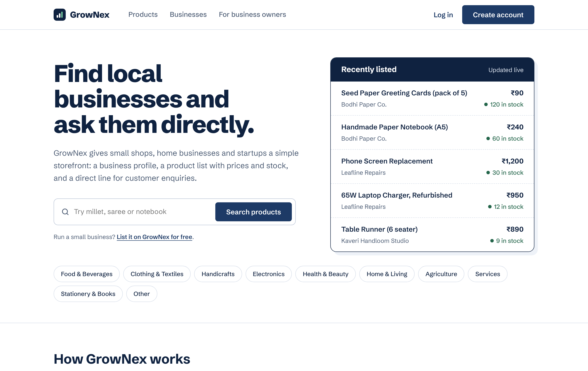
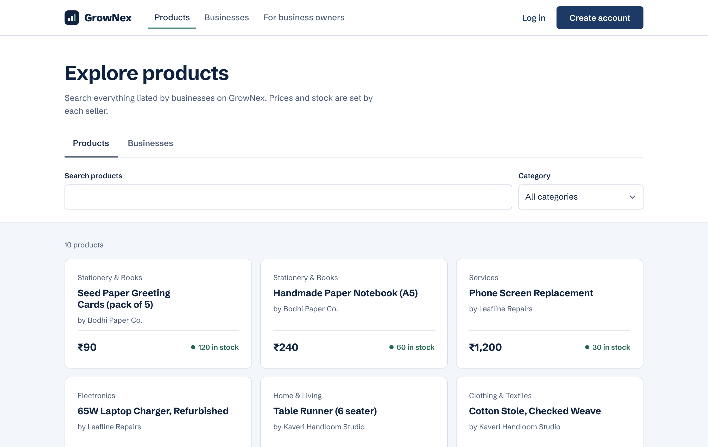
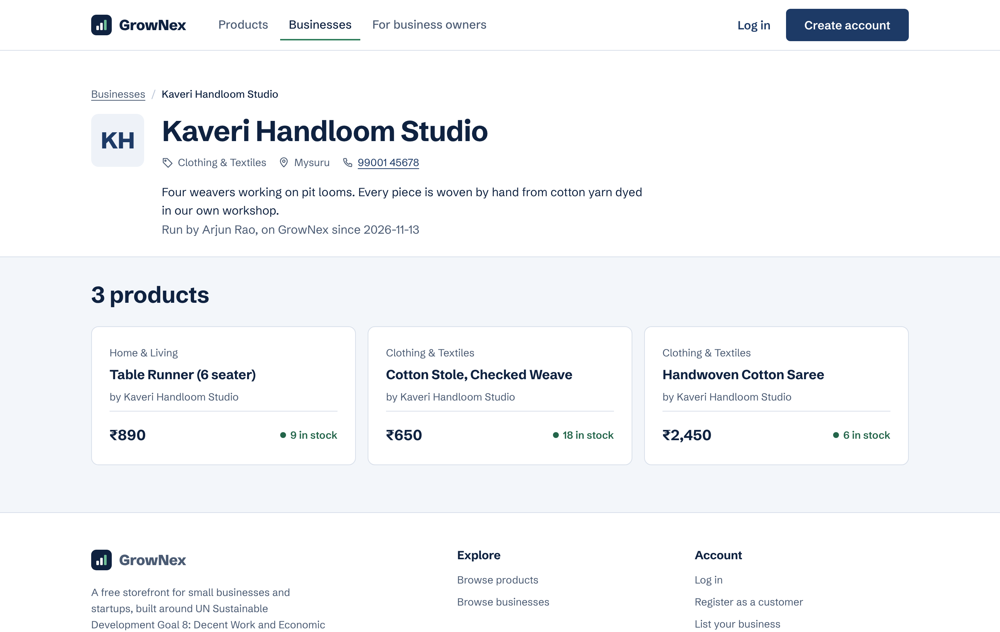
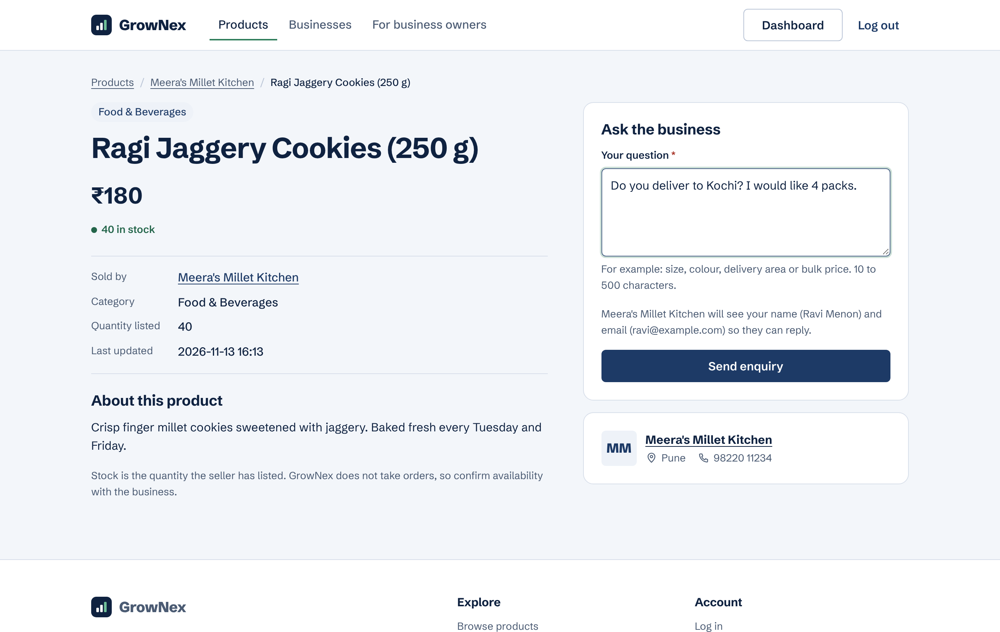
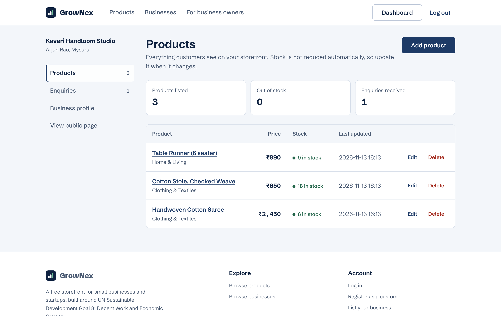
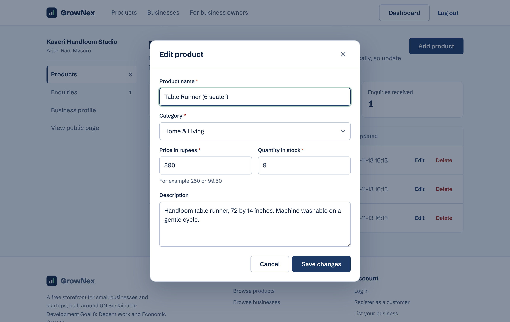
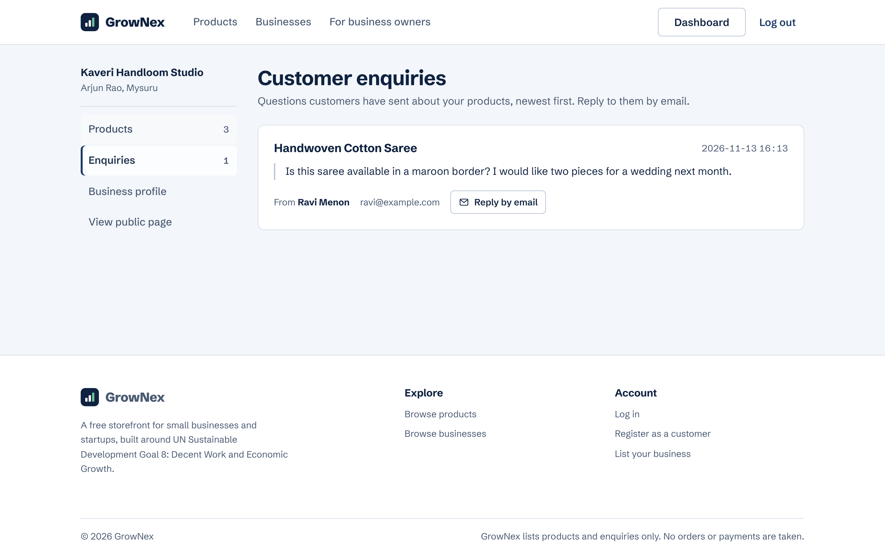
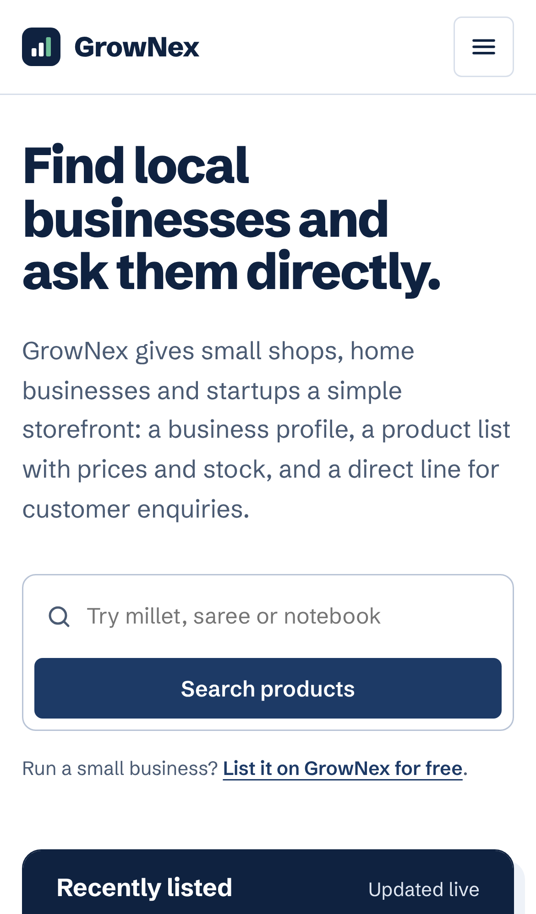

# GrowNex

**A digital growth platform for small businesses and startups**, built around UN Sustainable Development Goal 8: Decent Work and Economic Growth.

Business owners create a storefront with a business profile and a product list. Customers browse and search those products, check prices and stock, and send enquiries straight to the business. There are no orders or payments. GrowNex is a place to be found and contacted.

The frontend is plain HTML and CSS with a little vanilla JavaScript. The backend is a C++ program built with object-oriented programming. It uses [cpp-httplib](https://github.com/yhirose/cpp-httplib) as its web server and stores everything in `.txt` files. It runs only on your own computer at `http://localhost:8080`.



---

## Contents

1. [Features](#features)
2. [Technology stack](#technology-stack)
3. [Screenshots](#screenshots)
4. [Folder structure](#folder-structure)
5. [How the frontend talks to the C++ backend](#how-the-frontend-talks-to-the-c-backend)
6. [OOP design](#oop-design)
7. [Online preview (Vercel)](#online-preview-vercel)
8. [Installation](#installation)
9. [Build and run](#build-and-run)
10. [Setting up VS Code](#setting-up-vs-code)
11. [Demo accounts](#demo-accounts)
12. [API reference](#api-reference)
13. [Data files](#data-files)
14. [Security](#security)
15. [Testing checklist](#testing-checklist)
16. [Troubleshooting](#troubleshooting)
17. [Limitations](#limitations)

---

## Features

### Business owner
- Register and log in
- Create and edit the business profile (name, category, city, phone, description)
- Add, view, update and delete products (name, category, description, price, quantity)
- See a summary of products listed, products out of stock and enquiries received
- Read customer enquiries and reply by email (enquiries are view-only)

### Customer
- Register and log in
- Explore businesses and browse products
- Search by keyword and filter by category
- View product details, price and listed quantity
- View business information
- Send an enquiry about a product and see all enquiries already sent

### Rules
- Stock quantities are shown but never reduced automatically
- No ordering, cart or payment system
- No admin panel

---

## Technology stack

| Part | Technology |
|---|---|
| Frontend | HTML5, CSS3, vanilla JavaScript (`fetch` only, no frameworks) |
| Backend | C++17 using classes, inheritance and polymorphism |
| Web server | cpp-httplib v0.66.0 (single header file, included in `backend/lib`) |
| Storage | Text files read and written with C++ file streams (`fstream`) |
| Password hashing | Salted SHA-256, repeated 10,000 times (written in C++, no extra library) |
| Editor | Visual Studio Code |
| Runs on | `localhost` only |

> **Why is there JavaScript?** The brief asks for HTML forms to talk to the C++ backend through HTTP requests and **JSON responses**. A browser needs a few lines of JavaScript (`fetch`) to read JSON and update the page. No JavaScript framework or library is used.

---

## Screenshots

| Explore products | Business page |
|---|---|
|  |  |

| Product page with enquiry form | Business owner dashboard |
|---|---|
|  |  |

| Editing a product | Customer enquiries (owner view) |
|---|---|
|  |  |



---

## Folder structure

```text
GrowNex/
├── backend/
│   ├── include/              C++ header files (class declarations)
│   │   ├── User.h            abstract base class for all accounts
│   │   ├── Business.h        business owner account + public profile
│   │   ├── Customer.h        customer account
│   │   ├── Product.h         a product listed by a business
│   │   ├── Enquiry.h         a customer's question about a product
│   │   ├── FileManager.h     reads and writes the .txt files
│   │   ├── Server.h          HTTP routes and request handlers
│   │   ├── Security.h        SHA-256 and password hashing
│   │   └── Utils.h           text escaping, JSON helpers, Validator class
│   ├── src/                  C++ source files (class definitions)
│   │   ├── main.cpp          program entry point
│   │   └── ... one .cpp file for each header above
│   └── lib/
│       └── httplib.h         cpp-httplib web server library (MIT licence)
├── frontend/
│   ├── index.html            home page
│   ├── explore.html          search products / businesses
│   ├── business.html         one business and its products
│   ├── product.html          product details and enquiry form
│   ├── login.html
│   ├── register.html
│   ├── owner-dashboard.html  products, enquiries, profile
│   ├── customer-dashboard.html
│   ├── css/style.css         all styles
│   └── js/                   one small script per page + app.js (shared)
├── data/                     created at run time; .txt files are NOT committed
├── docs/screenshots/
├── .vscode/                  build task and IntelliSense settings
├── build.bat                 Windows build script
├── build.sh                  Linux / macOS build script
├── .gitignore
└── README.md
```

---

## How the frontend talks to the C++ backend

```text
 Browser (HTML + CSS + JS)                    C++ program (grownex)
 ─────────────────────────                    ───────────────────────────────────
 1. User submits a form
 2. JS: fetch("/api/login", POST, form)  ──►  cpp-httplib receives the request
                                              Server::handleLogin()
                                                ├─ Validator checks the input
                                                ├─ finds the User, checks password
                                                └─ creates a session
 4. JS reads the JSON, shows an          ◄──  3. Reply: {"ok":true,"redirect":...}
    error or opens the dashboard                + Set-Cookie: grownex_session=...
```

Step by step:

1. **The C++ program is the web server.** When you run `grownex`, the `Server` class starts cpp-httplib on `127.0.0.1:8080`.
2. **Pages are static files.** For `http://localhost:8080/explore.html`, the server sends the file from the `frontend` folder (`set_mount_point`).
3. **Data comes from `/api/...` routes.** Each page's script calls `GrowNex.api(...)` in `js/app.js`. That uses `fetch()` to send the request:
   - `GET` requests put search terms in the URL, for example `/api/products?q=saree`.
   - `POST` requests send the form as `application/x-www-form-urlencoded`. cpp-httplib parses that into `req.params`, and C++ reads it with `req.get_param_value("email")`.
4. **C++ replies with JSON.** Every class has a `toJson()` function, for example `Product::toJson()`. The handler joins these into a reply such as `{"ok":true,"products":[...]}`.
5. **JavaScript updates the page.** All text from the server goes through `esc()` before it is added to the page, so a product name like `<script>` shows as text and never runs.
6. **Login uses a cookie.** After login, the server sets an `HttpOnly` cookie holding a random session token. The browser sends it with every request. JavaScript cannot read it, which protects it from scripts.
7. **Every change is saved straight away.** When data changes, `FileManager` rewrites the matching `.txt` file. Restarting the program loads everything back.

---

## OOP design

```text
                 ┌──────────────────────────┐
                 │   User  (abstract)        │
                 │ - id, name, email         │
                 │ - passwordHash, salt      │
                 │ + checkPassword()         │
                 │ + getRole()        = 0    │
                 │ + dashboardPage()  = 0    │
                 │ + toJson()         = 0    │
                 │ + serialize()      = 0    │
                 └────────────┬─────────────┘
                 inherits     │     inherits
          ┌───────────────────┴───────────────────┐
┌─────────▼──────────┐                  ┌─────────▼──────────┐
│ Business           │                  │ Customer           │
│ - businessName     │                  │ - city             │
│ - category, city   │                  └────────────────────┘
│ - phone, description│
└────────────────────┘

 Product   Enquiry   FileManager   Server   Validator   PasswordHasher / Sha256
```

| Concept | Where to find it |
|---|---|
| **Classes and objects** | `User`, `Business`, `Customer`, `Product`, `Enquiry`, `FileManager`, `Server`. `main.cpp` creates a `Server` object; handlers create `Product`, `Enquiry`, `Business` and `Customer` objects. |
| **Encapsulation** | Data members are `private` or `protected`. Other code uses getters and member functions instead, for example `checkPassword()`, `updateProfile()` and `Product::update()`. The password hash can never be read from outside the class. |
| **Inheritance** | `class Business : public User` and `class Customer : public User` (`Business.h`, `Customer.h`). Both reuse `User`'s fields and `setPassword()` / `checkPassword()`. |
| **Polymorphism** | `User` declares pure virtual functions: `getRole()`, `dashboardPage()`, `toJson()` and `serialize()`. `Server::findUserByEmail()` returns a `User*` that points to either a `Business` or a `Customer`. `handleLogin()` calls `user->dashboardPage()` and `user->toJson()` without knowing which it is, and C++ runs the right version at run time. |
| **Abstraction** | `User` cannot be created on its own (it has pure virtual functions). `FileManager` hides how files are read and written; the server only calls `loadProducts()` / `saveProducts()`. |
| **Templates (bonus)** | `FileManager::loadAll<T>()` and `Server::nextId<T>()` work for any record class. |

---

## Online preview (Vercel)

The `frontend` folder can also be hosted on its own, for example on Vercel, as a **read-only preview**:

- Each page first asks the C++ server whether it is there (`/api/categories`). If there is no answer, the site switches to demo mode and reads the sample businesses and products from `frontend/js/demo-data.js`.
- Browsing, search, category filters, business pages and product pages work.
- Login, registration, dashboards and enquiries show "only available when running locally".
- When the C++ server is running, demo mode is never used and everything works as described above.

Vercel settings: **Root Directory** = `frontend`, **Framework Preset** = Other, no build command.

---

## Installation

You need three things: a C++17 compiler, VS Code and a web browser. cpp-httplib is already included as `backend/lib/httplib.h`, so there is nothing else to download.

### Windows (MSYS2 + MinGW-w64)

1. Download and install MSYS2 from <https://www.msys2.org/>.
2. Open **MSYS2 UCRT64** from the Start menu and run:
   ```bash
   pacman -S --needed mingw-w64-ucrt-x86_64-gcc
   ```
3. Add `C:\msys64\ucrt64\bin` to your Windows **Path**: Start → "Edit the system environment variables" → Environment Variables → Path → Edit → New.
4. Open a **new** Command Prompt and check:
   ```bash
   g++ --version
   ```
   You need GCC 9 or newer. cpp-httplib needs Windows 10 or 11.

### Linux (Ubuntu / Debian)

```bash
sudo apt update
```
```bash
sudo apt install g++
```

### macOS

```bash
xcode-select --install
```
This installs Apple's `clang`, which also answers to `g++`.

### Updating cpp-httplib (optional)

The project ships with cpp-httplib **v0.66.0**. To use another version, replace `backend/lib/httplib.h` with the `httplib.h` file from <https://github.com/yhirose/cpp-httplib/releases>.

---

## Build and run

Open a terminal **in the GrowNex folder** (the folder that contains `frontend` and `backend`).

### 1. Compile

Windows:
```bash
build.bat
```

Linux / macOS:
```bash
./build.sh
```

Or type the full command yourself. Windows:
```bash
g++ -std=c++17 -O2 -Wall -D_WIN32_WINNT=0x0A00 -Ibackend/include -Ibackend/lib backend/src/main.cpp backend/src/Server.cpp backend/src/FileManager.cpp backend/src/User.cpp backend/src/Business.cpp backend/src/Customer.cpp backend/src/Product.cpp backend/src/Enquiry.cpp backend/src/Security.cpp backend/src/Utils.cpp -o grownex.exe -lws2_32
```

Linux / macOS:
```bash
g++ -std=c++17 -O2 -Wall -Ibackend/include -Ibackend/lib backend/src/main.cpp backend/src/Server.cpp backend/src/FileManager.cpp backend/src/User.cpp backend/src/Business.cpp backend/src/Customer.cpp backend/src/Product.cpp backend/src/Enquiry.cpp backend/src/Security.cpp backend/src/Utils.cpp -o grownex -pthread
```

What the options mean:

| Option | Meaning |
|---|---|
| `-std=c++17` | Use the C++17 standard (needed for `std::filesystem`) |
| `-O2` | Optimise the program |
| `-Wall` | Show warnings |
| `-Ibackend/include -Ibackend/lib` | Where to find our headers and `httplib.h` |
| `-o grownex` | Name of the program to create |
| `-pthread` | Linux/macOS: the server uses several threads |
| `-lws2_32` | Windows: link the Windows networking library |
| `-D_WIN32_WINNT=0x0A00` | Windows: tell cpp-httplib we target Windows 10 or newer |

The first build takes 20 to 60 seconds, because `httplib.h` is a large file.

### 2. Run

First time, with demo data. Windows:
```bash
grownex.exe --seed
```
Linux / macOS:
```bash
./grownex --seed
```

After that, start it without `--seed`:
```bash
./grownex
```

You should see:
```text
Loaded 4 businesses, 1 customers, 10 products and 1 enquiries.
GrowNex is running at http://localhost:8080
Press Ctrl + C to stop the server.
```

### 3. Open the site

Go to **<http://localhost:8080>** in your browser. Stop the server with **Ctrl + C**.

To use another port:
```bash
./grownex --port 9090
```

> Always start the program from the GrowNex folder. It looks for `frontend/` and `data/` relative to where it is run.

---

## Setting up VS Code

1. Install VS Code from <https://code.visualstudio.com/>.
2. Install the **C/C++** extension by Microsoft (`ms-vscode.cpptools`). VS Code suggests it when you open the project, because of `.vscode/extensions.json`.
3. **File → Open Folder…** and choose the `GrowNex` folder.
4. Open a terminal with **Terminal → New Terminal** (`` Ctrl + ` ``).
5. **Build:** press **Ctrl + Shift + B**. This runs the "Build GrowNex" task in `.vscode/tasks.json`, which uses the right command for Windows or Linux/macOS. Compiler errors show in the Problems panel.
6. **Run:** **Terminal → Run Task… → Run GrowNex with demo data** the first time, then **Run GrowNex** after that. You can also type `grownex.exe` (Windows) or `./grownex` in the terminal.
7. Open <http://localhost:8080>.
8. After changing C++ code, stop the server (click in the terminal and press **Ctrl + C**), build again and run again. After changing HTML, CSS or JS, just refresh the browser.

`.vscode/c_cpp_properties.json` tells IntelliSense where the headers are, so `#include "httplib.h"` is not underlined in red.

---

## Demo accounts

These exist only after you run `grownex --seed` on empty data files. All demo accounts use the password **`Demo@1234`**.

| Role | Email | Business |
|---|---|---|
| Business owner | `meera@example.com` | Meera's Millet Kitchen, Pune |
| Business owner | `arjun@example.com` | Kaveri Handloom Studio, Mysuru |
| Business owner | `sana@example.com` | Leafline Repairs, Jaipur |
| Business owner | `tenzin@example.com` | Bodhi Paper Co., Bhopal |
| Customer | `ravi@example.com` | none |

The businesses and people are made up for testing. To start over with an empty site, stop the server and delete the four `.txt` files in `data/`.

---

## API reference

All responses are JSON with `"ok": true` or `"ok": false, "error": "message"`.

| Method | Path | Who | Purpose |
|---|---|---|---|
| POST | `/api/register` | anyone | Create an account (`role` = `business` or `customer`) and log in |
| POST | `/api/login` | anyone | Log in; returns the dashboard to open |
| POST | `/api/logout` | logged in | End the session |
| GET | `/api/me` | anyone | Who is logged in |
| GET | `/api/categories` | anyone | Category list |
| GET | `/api/businesses?q=&category=` | anyone | Search businesses |
| GET | `/api/businesses/{id}` | anyone | One business and its products |
| GET | `/api/products?q=&category=&limit=` | anyone | Search products, newest first |
| GET | `/api/products/{id}` | anyone | One product and its business |
| POST | `/api/owner/profile` | business | Update the business profile |
| GET | `/api/owner/products` | business | My products |
| POST | `/api/owner/products` | business | Add a product |
| POST | `/api/owner/products/{id}/update` | business | Edit my product |
| POST | `/api/owner/products/{id}/delete` | business | Delete my product |
| GET | `/api/owner/enquiries` | business | Enquiries about my products |
| POST | `/api/enquiries` | customer | Send an enquiry (`productId`, `message`) |
| GET | `/api/customer/enquiries` | customer | Enquiries I have sent |

Status codes: `400` invalid input, `401` not logged in, `403` wrong account type, `404` not found, `409` email already registered.

---

## Data files

Each record is one line; fields are separated by `|`. If a value itself contains `|`, a backslash or a new line, it is escaped as `\|`, `\\` or `\n`, so the file format never breaks.

| File | Fields |
|---|---|
| `data/businesses.txt` | `id|ownerName|email|passwordHash|salt|businessName|category|city|phone|description|createdAt` |
| `data/customers.txt` | `id|name|email|passwordHash|salt|city|createdAt` |
| `data/products.txt` | `id|businessId|name|category|description|price|quantity|updatedAt` |
| `data/enquiries.txt` | `id|productId|productName|businessId|customerId|customerName|customerEmail|message|createdAt` |

The product name is copied into each enquiry, so old enquiries still make sense after a product is deleted. New product IDs never reuse an ID that an old enquiry points to.

The `.txt` files contain names, emails and password hashes, so `.gitignore` keeps them out of GitHub.

---

## Security

| Measure | How |
|---|---|
| Password hashing | A random 16-byte salt per user; SHA-256 of salt + password, repeated 10,000 times. Only the hash and salt are stored. |
| Login errors | The same message for an unknown email and a wrong password, so the page does not reveal which emails are registered. |
| Sessions | 32-byte random token in an `HttpOnly`, `SameSite=Strict` cookie. |
| Authorisation | Every owner and customer route checks the session role. Owners can edit or delete only their own products. |
| Input validation | Done in the browser for quick feedback and **again in C++** (`Validator` class), because browser checks can be bypassed. |
| Output escaping | `jsonString()` in C++ produces valid JSON; `esc()` in JavaScript stops HTML or script injection. |
| Localhost only | The server listens on `127.0.0.1`, so other computers on the network cannot open it. |
| Thread safety | cpp-httplib uses several threads; a `std::mutex` protects shared data. |
| Single instance | A second copy of GrowNex on the same port refuses to start, so two copies cannot overwrite each other's files. |

**Honest note for a real deployment:** iterated SHA-256 is fine for a learning project. A production system should use a dedicated password-hashing algorithm such as Argon2 or bcrypt, and a cryptographically secure random generator. The C++ `std::mt19937_64` used here is seeded from `std::random_device` but is not designed for security. A real site would also need HTTPS and login rate limiting.

---

## Testing checklist

Every item below was tested end to end, both through the API with `curl` and in a real browser with Playwright, at desktop (1360px) and phone (375px) widths.

- [x] Register a business owner and a customer; duplicate email is rejected
- [x] Weak password, invalid email, invalid phone and empty fields are rejected with clear messages
- [x] Log in, log out, wrong password message
- [x] Owner adds, edits and deletes products; invalid price (e.g. `12.345`) is rejected
- [x] Owner cannot edit another business's products
- [x] Owner updates the business profile
- [x] Search by keyword, filter by category, switch between products and businesses
- [x] Product and business pages show price, stock and contact details
- [x] Logged-out visitors are asked to log in before sending an enquiry and are returned to the product afterwards
- [x] Customer sends an enquiry; it appears on both dashboards
- [x] Business owners cannot send enquiries; customers cannot open the owner dashboard
- [x] Data survives a server restart; `|`, quotes and new lines in descriptions are stored safely
- [x] No horizontal scrolling on a 375px-wide phone screen

---

## Troubleshooting

| Problem | Fix |
|---|---|
| `'g++' is not recognized` | MinGW is not on your Path. Repeat installation step 3, then open a **new** terminal. |
| `Cannot find frontend/index.html` | You started the program from the wrong folder. `cd` into the GrowNex folder first. |
| `Could not start on port 8080` | Another program, or another copy of GrowNex, is using the port. Close it or run `grownex --port 9090`. |
| `undefined reference to __imp_WSA...` (Windows) | Add `-lws2_32` at the **end** of the compile command. |
| `cpp-httplib doesn't support Windows 8 or lower` | Add `-D_WIN32_WINNT=0x0A00` to the compile command and use Windows 10 or 11. |
| Page says "Cannot reach the GrowNex server" | The C++ program is not running. Start it and refresh. |
| Site shows "Online preview" while testing locally | The C++ server is not running, or the page was opened by double-clicking the file. Start `grownex` and open `http://localhost:8080`. |
| Fonts look plain | The Schibsted Grotesk font loads from Google Fonts. Offline, the site falls back to a system font; everything still works. |

---

## Limitations

- Sessions are kept in memory, so everyone is logged out when the server restarts.
- One business profile per business owner account.
- Owners reply to enquiries by email, outside GrowNex (enquiries are view-only by design).
- No product images, to keep file storage simple.
- Whole files are rewritten on each change. That is fine for a class project, but not for thousands of records.

---

## Team

| Name |
|---|
| Raghav Sharma |
| Asif Mirza |

---

## Credits

- [cpp-httplib](https://github.com/yhirose/cpp-httplib) by Yuji Hirose, MIT licence (`backend/lib/httplib.h`)
- [Schibsted Grotesk](https://fonts.google.com/specimen/Schibsted+Grotesk) via Google Fonts, SIL Open Font Licence

Built as a first-year BTech IT project on UN SDG 8: Decent Work and Economic Growth.
